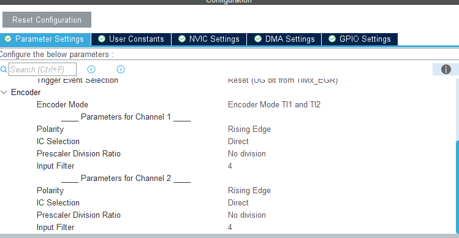
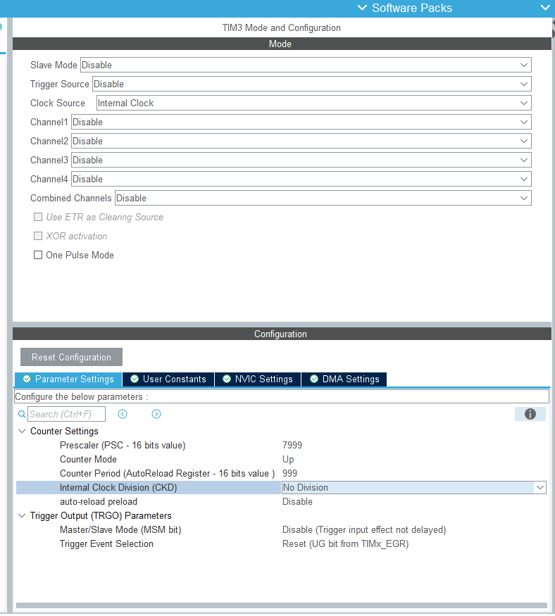
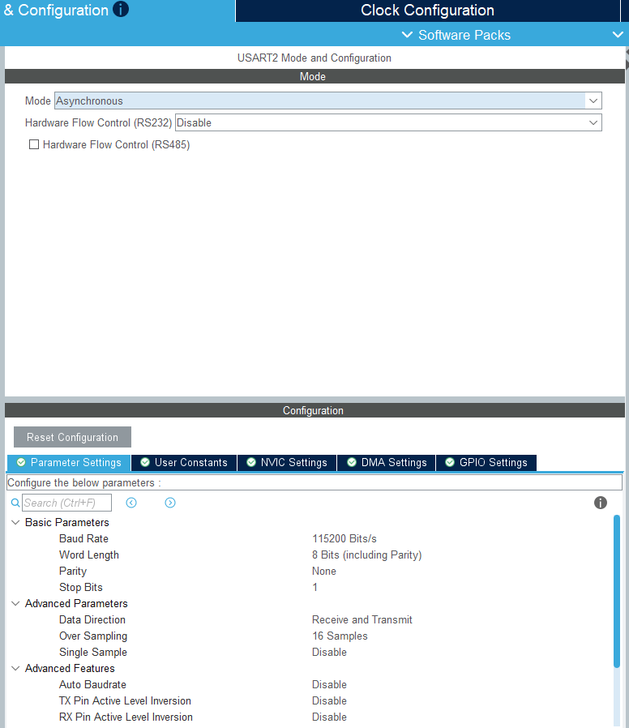

# STM32 Artımlı Encoder ile Darbe, Yön ve Hız Ölçümü

**Hazırlayan:** Deniz Özcan  
**Mikrodenetleyici:** STM32F091RCT6  
**Kullanılan yapı:** STM32 HAL

## Proje hakkında

Bu çalışmada A ve B kanallı artımlı bir encoder'ın darbelerini STM32'nin donanımsal timer birimini kullanarak saydım. Yazılım, dönüş yönünü ve RPM değerini her saniye yeniden hesaplıyor; darbe, yön ve hız bilgilerini USART2 üzerinden gönderiyor.

Encoder sayımı için TIM2'yi encoder modunda kullandım. Böylece A ve B sinyallerini yazılımsal GPIO kesmeleriyle takip etmek yerine bu işi doğrudan timer donanımı yapıyor. Bir saniyelik ölçüm aralığı ise TIM3 kesmesiyle oluşturuluyor.

Kart şu anda elimde olmadığı için fiziksel encoder ve UART testi yapamadım. Buna karşılık proje STM32CubeIDE üzerinde hatasız derlendi. HAL'den bağımsız tuttuğum hesaplama kodunu da masaüstü ortamında ileri dönüş, geri dönüş, durma ve sayaç taşması senaryolarıyla test ettim.

## Pinler ve çevre birimleri

| İşlev | Birim / Pin | Ayar |
| --- | --- | --- |
| Encoder A | TIM2_CH1 / PA0 | Rising edge, direct input, filter 4 |
| Encoder B | TIM2_CH2 / PA1 | Rising edge, direct input, filter 4 |
| Ölçüm zamanlayıcısı | TIM3 | 1 saniyede bir update interrupt |
| UART TX | USART2_TX / PA2 | 115200 baud, 8N1 |
| UART RX | USART2_RX / PA3 | 115200 baud, 8N1 |
| Debug | PA13 / PA14 | SWDIO / SWCLK |

### TIM2 encoder ayarı

TIM2, iki kanalı da kullanan `TI1 and TI2` encoder modunda çalışıyor. Sayaç 32 bit olduğu için periyot değeri `4294967295` olarak bırakıldı. Her iki kanalda da giriş filtresi `4` seçildi.



### TIM3 ölçüm aralığı

Timer clock frekansı 8 MHz. TIM3 için prescaler `7999`, period değeri `999` olarak ayarlandı:

```text
8.000.000 / ((7999 + 1) × (999 + 1)) = 1 Hz
```

Bu nedenle TIM3 her saniye bir kesme oluşturuyor.



### USART2

Ölçüm sonuçları USART2 üzerinden `115200 baud, 8 data bit, parity yok, 1 stop bit` ayarıyla gönderiliyor.



## Yazılımın çalışma şekli

1. TIM2, encoder'ın A ve B kanallarındaki geçişlere göre sayacı artırıyor veya azaltıyor.
2. TIM3 her saniye kesme oluşturuyor.
3. Kesme fonksiyonu yalnızca `measurement_due` bayrağını set ediyor.
4. Ana döngü TIM2 sayacını okuyor ve önceki değerle arasındaki farkı hesaplıyor.
5. Farkın işaretine göre yön `CW`, `CCW` veya `STOP` olarak belirleniyor.
6. RPM hesaplanıp UART mesajı hazırlanıyor.

UART gönderimini kesme içinde yapmadım. `HAL_UART_Transmit()` beklemeli çalışabildiği için kesme süresini gereksiz yere uzatmaması adına hesaplama ve gönderim ana döngüde yapılıyor.

## RPM hesabı

Görevde bir tur için 100 darbe kabul edildiğinden `ENCODER_COUNTS_PER_REV` değeri `100U` olarak tanımlandı.

```text
RPM = |ölçülen darbe farkı| × 60000
      --------------------------------------
      tur başına darbe × ölçüm süresi (ms)
```

Örneğin bir saniyede 100 darbe sayılırsa:

```text
RPM = 100 × 60 / 100 = 60 RPM
```

Ondalıklı `printf` desteğini açmamak için RPM değeri yazılım içinde 100 ile çarpılmış tam sayı olarak tutuluyor. Örneğin `6035`, UART çıktısında `60.35 RPM` şeklinde yazdırılıyor.

Motor durduğunda iki ölçüm arasındaki sayaç farkı sıfır oluyor. Bu durumda yön `STOP`, RPM ise `0.00` olarak güncelleniyor.

## UART çıktı örneği

Hareket sırasında:

```text
Pulse: 100, Total Pulse: 500, Direction: CW, RPM: 60.00
```

Motor durduğunda:

```text
Pulse: 0, Total Pulse: 500, Direction: STOP, RPM: 0.00
```

## Dosya yapısı

```text
Core/Inc/encoder.h       Encoder veri yapıları ve fonksiyon bildirimleri
Core/Src/encoder.c       Darbe farkı, yön, toplam darbe ve RPM hesabı
Core/Src/main.c          Timer başlangıçları, kesme bayrağı ve UART gönderimi
Tests/encoder_test.c     Donanımdan bağımsız hesaplama testleri
.github/workflows/       GitHub üzerinde otomatik test
*.ioc                    STM32CubeMX çevre birimi ayarları
```

## Derleme ve test

Proje STM32CubeIDE ile derlendi:

```text
Build Finished. 0 errors, 0 warnings.
```

Encoder hesaplama modülü HAL'e bağlı olmadığı için normal bir C derleyicisiyle ayrıca test edilebiliyor:

```bash
gcc -DENCODER_HOST_TEST -std=c11 -Wall -Wextra -Werror \
  -ICore/Inc Core/Src/encoder.c Tests/encoder_test.c \
  -o encoder_test
./encoder_test
```

Test edilen durumlar:

- 100 ileri darbe: `CW`, `60.00 RPM`
- 50 geri darbe: `CCW`, `30.00 RPM`
- Darbe gelmemesi: `STOP`, `0.00 RPM`
- 32 bit sayacın ileri ve geri yönde taşması
- Yön bilgisinin metne çevrilmesi

Test sonucu:

```text
All encoder tests passed.
```


